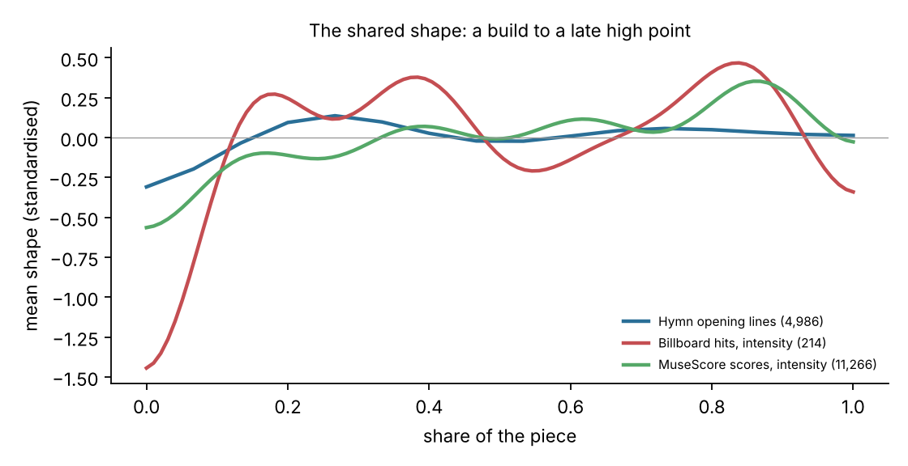

# The answer

Songs share one shape, but they do not come in types. In all three collections, songs build toward a high point late in the piece. Pop songs and MuseScore scores peak around two-thirds to four-fifths of the way through, and hymn opening lines climb to their high point about a quarter of the way in. Around that shared build, though, songs vary smoothly. They do not fall into a handful of shapes the way Reagan found six for stories. Each collection was tested against a featureless continuum with the same spread, and none clustered better than it.

Shape barely predicts success. Across 4,986 hymn tunes, 214 Billboard hits (plus 739 for song structure) and 11,266 MuseScore scores, shape added between 0.2% and 3% of the explained variation in success, after controls. Only the large samples reach statistical significance, and only because they are large.

So music has a story-arc equivalent, but it is one arc, not a menu of six, and it is a craft norm rather than a success formula.

# The data

| Collection | Pieces | The curve | Success measure | Licence |
|---|---|---|---|---|
| Hymnary.org tune export | 4,986 tunes (the top 5,000 by printings) | the opening line's melodic contour, from scale degrees | Total Instances: published text-tune pairings (median 33) | Hymnary's terms; only derived counts are kept |
| CoCoPops Billboard (McGill Billboard plus melodies) | 214 songs with melody; 739 with harmony and sections | intensity per bar: melodic height and whether the voice is singing, weighted by what listeners felt (below) | chart peak and weeks on the Hot 100, 1958 to 1991 | CC BY-NC 4.0 |
| PDMX (public-domain MuseScore scores) | 11,266 scores (a random 12,000 of 50,121 deduplicated, licence-clean scores of 24 to 400 bars) | intensity per bar: the top line's height, note onsets, notes struck together and loudness (velocity), averaged | views, favourites, star rating (2,047 with three or more ratings) | CC0 / public domain |

The Free Music Archive's play counts were downloaded too. The archive gives only whole-track summaries, though, not curves over time, and its full audio runs to hundreds of gigabytes, so it can't be used for shape. The Sacred Harp use ranks (554 songs, 1995 to 2025) were also downloaded, but no score files could be reached. sacredharpbremen.org is blocked from here.

# The method, and its self-test

Each piece's curve is resampled to relative time, smoothed with a cosine transform (which avoids the false humps a Fourier filter makes), and standardised so that only its shape counts. Two questions are then tested separately. The first is whether the pieces share a shape: the real pieces are compared with the same pieces with their bars shuffled. The second is whether the shapes fall into types: k-means clustering on the real curves is compared with curves drawn from a Gaussian with exactly the real covariance, which gives a continuum with the same modes and no types, and the clusters must also hold up when the data are resampled.

Before any real data was used, the method was checked on synthetic sets (Stage 0):

- A set built from three types was found to have types.
- A continuum was found to have none. A first version of the test wrongly found types here, because standardising curves bends the data. The null models are now drawn before standardising and standardised the same way.
- A set with a common shape had its shared shape detected: the mean curve's strength was 0.60, against 0.08 at the 95th percentile of the null.
- Pure noise showed no shared shape (0.02 against 0.08).

# Results

| | Hymn openings | Billboard | PDMX |
|---|---|---|---|
| Shared shape (mean curve strength, real against null 95th percentile) | 0.107 against 0.020 | 0.412 against 0.090 | 0.192 against 0.025 |
| First mode's share of variation (null 95th) | 43% (22%) | 21% (16%) | 18% (12%) |
| Types beyond a continuum? | no at 2 to 5 groups (less clustered than the continuum); a weak sign at 6 | no | no |
| Where the high point falls in each piece | mean 0.44 of the line (the mean curve peaks at about 0.27) | median 0.74 of the song; 58% in the last third | median 0.64; 47% in the last third |
| Variation explained by controls | 7.3% of log printings | year and length | 45% of log views |
| Added by shape | 0.27% (p = .04) | 3.3% of chart peak (p = .31), 2.5% of weeks (p = .47) | 0.16% of views, 0.21% of favourites (both p < .001); 0.5% of rating (p = .08) |

What the shared shape looks like:

- **Billboard:** a quiet start (the intro, before the voice), then waves of verse and chorus, with the highest point at about 0.84 of the song and a fall at the end.
- **PDMX:** a steady rise, highest at about 0.86.
- **Hymn openings:** a climb to the line's high point about a quarter of the way in, then a level line.

The largest single shape term anywhere is small:

- **Hymns:** tunes whose opening lines change direction less often are printed slightly more (β = −0.035, p = .01).
- **PDMX:** the arch-like mode goes with slightly more views (β = −0.023 on a mode that runs against an arch, p = .001).

A second random sample of 12,000 PDMX scores gave the same picture: a shared shape (0.205 against 0.024), no types, a median high point at 0.64, and shape adding 0.19% of views and 0.23% of favourites, with the same arch-like mode the most consistent term (β = −0.026). Rating again showed nothing (p = .51).

Song structure, tested on 739 Billboard songs (610 with a labelled chorus, a median of 44 seconds to the first chorus), showed no single effect. The time to the first chorus, its share of the song and the number of choruses together add 1.4% to weeks on the chart (p = .03) and 0.7% to chart peak (p = .24).

# What listeners felt

A hundred of the Billboard songs carry listeners' moment-by-moment ratings of arousal, along with the audio's loudness. Across 10,195 bars:

- **Time:** the strongest single predictor of felt arousal was how far into the song the bar falls (R² = 0.047). Arousal climbs through a song even where the notes do not.
- **Loudness:** the audio's level came next (R² = 0.033).
- **Notes:** the note measures together reached R² = 0.014. Whether the voice is singing mattered most (β = 0.22), then melodic height (β = 0.10). Busier melody counted slightly against (β = −0.04), and chord changes not at all.
- **All together:** R² = 0.088.

So a curve built from the notes catches only part of what listeners feel. The part it misses (loudness, and the build over time itself) is the part an arranger controls.

# What this means for the engine

1. **Plan one intensity curve for the whole song, and build it.** The high point goes between about 0.65 and 0.85 of the length, followed by a short release. Evidence: this study's three collections and the Chinese pop study (peak at 0.73 to 0.78).
2. **Raise each return above the last.** Felt arousal climbs with time in the song, so a repeated chorus at the same level will feel flatter than the first. This supports the lift rule (749.8) and the energy arc in the songbook protocol.
3. **Put the intensity in what listeners hear.** The voice entering, a higher melody, and loudness and texture all count; harmony changes on their own do not.
4. **Don't offer a menu of shapes.** Songs vary continuously around the shared build, so the engine should score how far a song departs from the build, not which "type" it is.
5. **Weight shape lightly when judging a song.** It explains well under 1% of success in the large samples. It is a craft check, not a hit predictor.
6. **Hymn openings:** let the first line climb to its high point early, and prefer fewer direction changes. Both effects are small.

# Limits

- The Hymnary sample is the top 5,000 tunes, so very rarely printed tunes are missing, which narrows the range of the outcome. Tune age isn't controlled for: only 665 rows give a year.
- The Billboard melody sample is small (214), so it can detect only effects of about r = 0.2 or larger.
- PDMX views mostly reflect the song being arranged, not the arrangement. Song fame was controlled with the number of scores sharing the song's name, but that is a rough measure.
- All the curves come from the notes alone. The listener data show that note-based curves catch only part of felt intensity.
- The hymn result at six groups is a weak sign, not a finding. It needs confirming on a second hymn sample.

# Next

1. Run the same tests on the Sacred Harp use ranks once scores can be reached: allow sacredharpbremen.org, or attach the files. Leaders choose freely what to lead there, so it is the cleanest success measure available.
2. Run Stage 3: have the engine write the same song with different shapes (an early peak, a late peak, a flat arc) and ask listeners which they prefer. That is the field's biggest gap.
3. Port the intensity curve and the late-peak check into the engine (finding 749.17).

All scripts and results are in studies/shapes. Raw data is not included, by licence.
